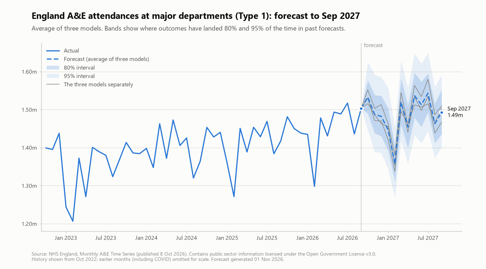

# Forecasting NHS England A&E attendances, with honest backtesting

Monthly attendances at major (Type 1) A&E departments in England, forecast 12
months ahead. The point of the project is not a clever model. It is an
evaluation that does not flatter itself: every forecast in the backtest uses
only the data that existed at the time, and the final forecast is frozen in
this repository before the next data release so it can be scored live.

## The frozen forecast

`outputs/forecast_type1_2026-09.csv` and `.json` hold the forecast made from
data up to September 2026 (published by NHS England on 8 Oct 2026). They were
generated on 1 Nov 2026 and are committed before the October 2026 figures are
released (expected 12 Nov 2026). **They must not be edited or regenerated.**
Scoring against the real figures will be added as each month is published,
whether the forecast looks good or bad.

## What was done

- Cleaned the messy NHS Excel file (header on row 14, estimated months,
  changing definitions) into a tidy table.
- Walk-forward backtest from June 2015, horizons 1 to 12 months. Results are
  split into before COVID, COVID, recovery and settled periods, because the
  COVID years dominate any single average.
- Baselines: naive and seasonal naive ("same month last year").
- Models: Holt-Winters (ETS), SARIMA, ridge regression and gradient boosting on
  lag features. COVID-aware versions leave the COVID months out of training.
- Prediction intervals built from each model's own past errors (known at the
  time of the forecast), with a coverage check.
- Final forecast: equal-weight average of ETS, SARIMA (COVID months masked) and
  COVID-aware ridge, chosen by a decision rule written down before looking at
  the combination results.

## Caveats

- The COVID window and the "stable" error history for the intervals were
  chosen after seeing results (hindsight). Both are flagged in the scripts.
- Many models and variants were compared, so the best-looking result is
  partly luck. The write-up will list every variant tried.
- About a fifth of SARIMA fits did not report convergence.
- Coverage was only checked at horizons 1, 3, 6 and 12. Interval widths at
  neighbouring horizons are not smooth.
- The 80% intervals may be slightly too narrow in the settled period.
- Months from Nov 2010 to May 2015 were estimated from weekly data and are
  never scored.

## Reproduce

Python 3 on Windows, from the project folder with a virtual environment:

    pip install -r requirements.txt
    python scripts\02_load_clean.py
    python scripts\04_prepare_dataset.py
    python scripts\07_models_ets_sarima.py
    python scripts\08_models_ml.py
    python scripts\10_models_ml_covidaware.py
    python scripts\11_prediction_intervals.py
    python scripts\12_combinations.py

Scripts 01, 03, 05, 06 and 09 are inspection, exploration and diagnostics.
Script 13 produces the final forecast and includes a proof step: it re-runs a
past forecast with the shipped code and stops unless it matches the backtest.
Do not run 13 again and commit the result.

## Data and licence

Data: NHS England, Monthly A&E Time Series (Activity sheet), in `data/raw`.
Contains public sector information licensed under the
[Open Government Licence v3.0](https://www.nationalarchives.gov.uk/doc/open-government-licence/version/3/).

Code: MIT, see `LICENSE`.
